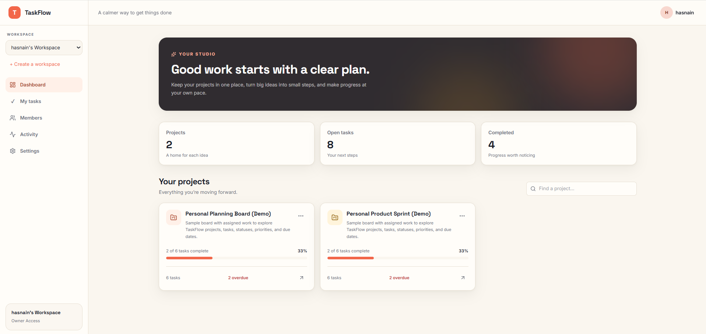
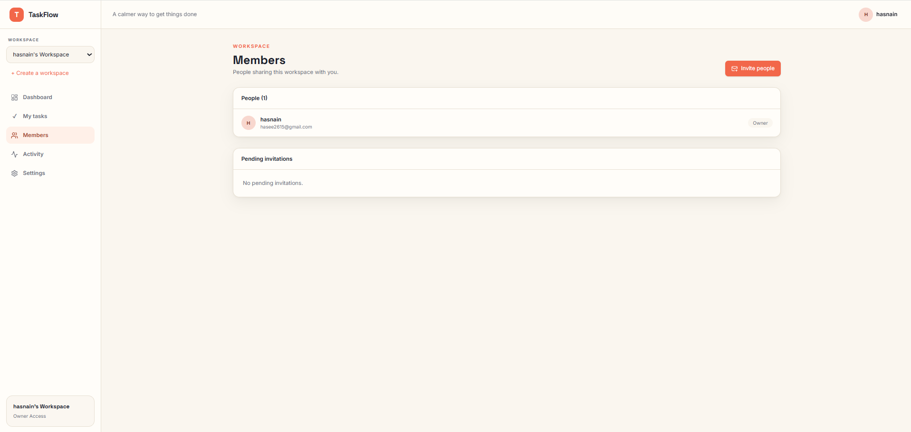
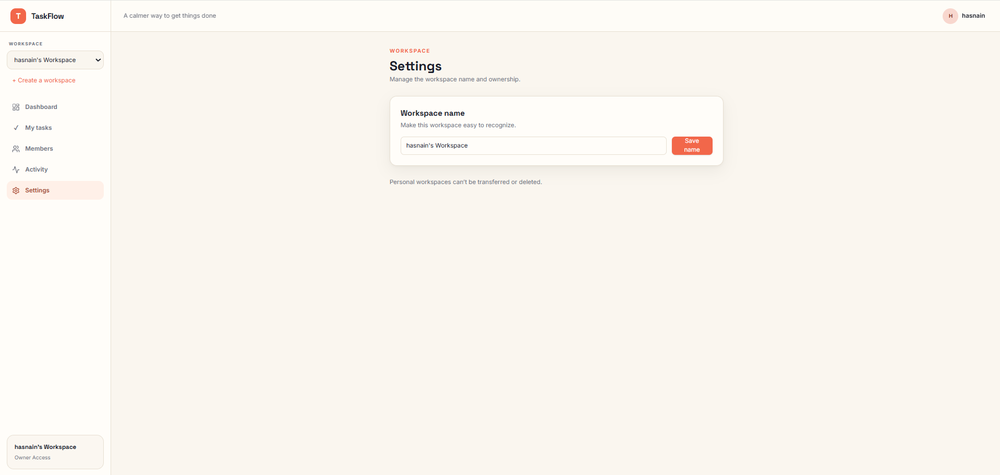
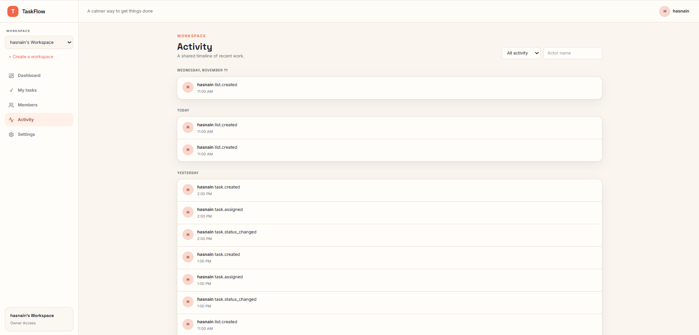

# Taskflow - Task Management System

## Overview

Taskflow is a task management and collaboration app for organizing work in workspaces, projects, lists, and task boards. It includes cookie-based authentication, role-based workspace access, task assignments, and activity tracking.

## Screenshots

### Sign in and account creation

| Sign in | Create account |
|---|---|
| [](docs/screenshots/sign%20in.png) | [](docs/screenshots/create%20account.png) |

### Workspace

| Dashboard | My tasks |
|---|---|
| [](docs/screenshots/dashboard.png) | [](docs/screenshots/my%20tasks.png) |

| Members | Settings |
|---|---|
| [](docs/screenshots/members.png) | [](docs/screenshots/settings.png) |

### Activity

| Workspace activity |
|---|
| [](docs/screenshots/activity.png) |

## Features

### Dashboard
The dashboard gives workspace members a central place to view and open their projects.

### Project boards
Projects organize work into customizable lists and support drag-and-drop task and list ordering.

### Task management
Tasks support descriptions, status, priority, due dates, labels, subtasks, and one or more assignees.

### Search and filters
Search, status, priority, due-date, label, and assignee filters, sorting, and board/list views help users find and organize tasks.

### Workspaces and roles
Workspaces provide shared projects and enforce owner, admin, member, and viewer permissions through the API.

### Team collaboration
Workspace invitations, member management, task comments, and activity history support team coordination.

### My tasks
The My Tasks page brings together tasks assigned to the signed-in user across a workspace.

### Authentication
Sign-up, sign-in, password reset, and invitation acceptance use protected routes and HTTP-only cookie-based sessions.

## Tech Stack

- **Frontend:** React 19, Vite, Tailwind CSS 4, React Router, TanStack Query, Axios, dnd-kit, and Lucide.
- **Backend:** Node.js, Express 4, and Mongoose.
- **Database:** MongoDB.
- **Authentication and security:** JSON Web Tokens in cookies, bcryptjs, Helmet, CORS, request validation, and rate limiting.
- **Email:** Nodemailer for production password-reset and invitation emails.
- **Testing:** Vitest and Testing Library for the client; Jest, Supertest, and mongodb-memory-server for the server.

## Architecture

```text
Browser
  React + Vite client
    Pages and shared components
    TanStack Query + Axios (/api)
           |
           | Vite development proxy
           v
  Express API
    Routes -> middleware -> controllers -> Mongoose models
           |
           v
        MongoDB
```

The client uses the Vite development server at `http://localhost:5173` and proxies `/api` requests to the Express API at `http://localhost:5000`. The server validates requests, authenticates users, and checks workspace permissions before accessing MongoDB.

## Entity Relationships

Taskflow stores its data in MongoDB collections and connects documents with Mongoose references:

- A **User** can own or create workspaces, projects, and tasks, and can join workspaces through **Membership** documents.
- A **Workspace** has an owner, memberships, projects, invitations, and activity records.
- A **Project** belongs to a workspace and contains **Lists**, **Tasks**, and **Labels**.
- A **Task** belongs to a project and list, can have multiple assignees and labels, and can contain embedded subtasks.
- A **Comment** belongs to a task, project, and workspace and records its author.
- An **Invitation** belongs to a workspace and records its inviter, intended email, role, and status.
- An **ActivityLog** belongs to a workspace and can reference the acting user and affected entity.

```text
User ──< Membership >── Workspace ──< Project ──< List ──< Task
  │                           │          │                 ├──< Comment
  ├── owns/creates ───────────┘          ├──< Label         ├──< Subtask (embedded)
  └── assigned to ───────────────────────┘                 └──< Label references
                              ├──< Invitation
                              └──< ActivityLog
```

### Workspace roles

| Role | Permissions |
|---|---|
| Owner | Full workspace control, including ownership transfer, role management, and workspace deletion. |
| Admin | Manage members and invitations, rename the workspace, and manage its projects and task content. |
| Member | Create projects and manage project content, subject to project ownership rules. |
| Viewer | Read workspace projects, tasks, comments, activity, and member lists. |

## Installation and Run (Windows)

### Requirements

- Windows PowerShell
- Node.js and npm
- MongoDB running locally, or a MongoDB Atlas connection string

### Install dependencies

Run these commands from the repository root:

```powershell
npm install --prefix .\server
npm install --prefix .\client
```

### Configure the backend

Create `server\.env` from the example if it does not already exist:

```powershell
if (-not (Test-Path .\server\.env)) { Copy-Item .\server\.env.example .\server\.env }
```

Edit `server\.env` and set:

- `MONGO_URI` to your local MongoDB URI or MongoDB Atlas connection string.
- `JWT_SECRET` to a private random secret of at least 32 characters.
- `CLIENT_URL` to `http://localhost:5173` for local development.

To generate a random secret in PowerShell, run:

```powershell
node -e "console.log(require('crypto').randomBytes(32).toString('hex'))"
```

The example file uses a local MongoDB URI at `mongodb://127.0.0.1:27017/taskflow`. SMTP settings are only required when running in production; development password-reset and invitation links are printed in the server terminal.

### Start the application

Start the backend in one PowerShell terminal:

```powershell
npm run dev --prefix .\server
```

Start the frontend in a second terminal:

```powershell
npm run dev --prefix .\client
```

Open [http://localhost:5173](http://localhost:5173) in your browser. The backend API runs at `http://localhost:5000`.

### Existing database migrations

The backend runs the account-name and workspace backfills on startup. For an existing installation with older task/list records, run the idempotent Phase 1 migration:

```powershell
npm run migrate:phase1 --prefix .\server
```

Before upgrading an existing database, back it up. Review the Phase 2 migration with a dry run, then apply it:

```powershell
npm run migrate:phase2 --prefix .\server -- --dry-run
npm run migrate:phase2 --prefix .\server
```

### Tests and checks

```powershell
npm test --prefix .\server
npm test --prefix .\client
npm run build --prefix .\client
npm run lint --prefix .\client
```
